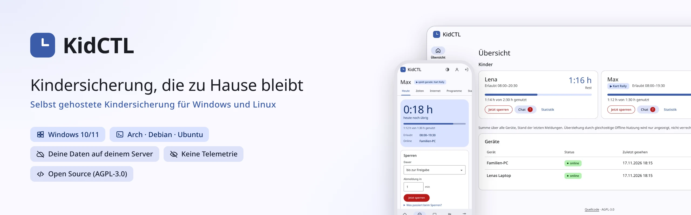

<div align="center">
<a href="https://adriannoss.github.io/kidCTL/de/">
<picture>
<source media="(prefers-color-scheme: dark)" srcset="docs/img/de/banner-dark.webp">

</picture>
</a>
</div>

# KidCTL

[English](README.md) · **Deutsch**

[](https://scorecard.dev/viewer/?uri=github.com/AdrianNoss/kidCTL)  
<sub>Automatisch geprüft (Konfiguration und Repo-Praktiken, kein Siegel); Sicherheitslücken bitte wie in [SECURITY.de.md](SECURITY.de.md) beschrieben melden.</sub>

Selbst gehostete Kindersicherung für **Windows 10 (22H2) und Windows 11 (ab 23H2)** (x64, Home und Pro) sowie
**Arch Linux, Debian und Ubuntu** (auch Mint, Pop!_OS) **mit KDE Plasma oder GNOME (Wayland)**. Ein zentraler Server
mit Eltern-WebUI (auch als App aufs Handy) steuert einen Root-Agenten auf jedem Kinderrechner. Alle
Daten bleiben auf dem eigenen Server, es gibt keine Cloud und kein Konto bei Dritten.

WebUI, E-Mails, Push-Benachrichtigungen und alles, was das Kind sieht (Benachrichtigungen, Tray-App), gibt es auf
**Deutsch und Englisch**. Eltern wählen ihre Sprache im Profil (Standard: Browsersprache); auf dem Kinderrechner
gilt die Sprache der Desktop-Sitzung.

## Funktionen

- **Bildschirmzeit**:
  - Tageskontingent und Zeitfenster je Wochentag, Zählung über alle Rechner eines Kindes.
  - Warnungen vor Ablauf, danach Abmeldung und Login-Sperre (SDDM, GDM und TTY; Windows: Konto des Kindes
    wird deaktiviert).
  - Funktioniert auch offline mit der zuletzt bekannten Regel.
- **Spiele-Limit**: optional ein eigenes Tageskontingent für Spiele (Steam, Heroic und Apps der Gruppe
  „Spiele“; unter Windows auch Epic, EA app, GOG Galaxy, Battle.net und Spiele, die ein Launcher wie Ubisoft Connect
  oder Wargaming startet); Spiele werden nach einer Vorwarnung geschlossen, der Rest des Rechners bleibt nutzbar.
- **Anfragen und Chat**: Das Kind fragt in der Tray-App nach mehr Zeit, mehr Spielzeit oder der Freigabe einer
  gesperrten App bzw. Website oder schreibt eine Nachricht; die Eltern antworten per Push auf dem Handy –
  „Dauerhaft erlauben“, „Nur heute“ oder „Ablehnen“.
- **Programm-Whitelist**:
  - Modi „Nur protokollieren“ oder „Sperren“.
  - Katalog der installierten Apps, Flatpak (systemweit), Steam und Heroic, unter Windows Startmenü und Store-Apps.
  - Eigene Programme im Home sind durch noexec blockiert (Windows: Ausführverbot im Benutzerprofil).
- **Website-Filter** (DNS):
  - Whitelist mit Dienst-Bundles (YouTube, Wikipedia, Lern-Apps, Microsoft 365) oder Blacklist mit
    Sperrlisten (HaGeZi, OISD, StevenBlack).
  - SafeSearch je Kind.
  - DNS-over-HTTPS bzw. DoT der Browser sind gesperrt.
- **Auswertung**: Statistik pro Tag, Programm und Spiel, ein Protokoll gesperrter Programme und
  Domains sowie optional ein wöchentlicher oder monatlicher Nutzungsbericht per E-Mail. Ein Verlauf erlaubter
  Websites wird **nicht** gespeichert.
- **Alarme per Push**:
  - Gerät zu lange offline.
  - Schutzmaßnahme manipuliert, z. B. PAM, nftables oder noexec.
- **Offen gegenüber dem Kind**: Beim ersten Anmelden erklärt die Tray-App, dass der Account von KidCTL
  verwaltet wird und was erfasst wird; das Symbol bleibt sichtbar, einen verdeckten Modus gibt es nicht.
- **Eure Daten**: Export aller Daten einer Familie als ZIP (lesbar, versioniert) und Import auf einem anderen
  KidCTL-Server – auch für den Umzug zwischen Self-Hosting und gehostetem Betrieb.
- **Mehrere Familien** (`KIDCTL_MODE=saas`): Registrierung mit Einladungscode, Abo mit Testphase, Support-Tickets
  und ein Verwaltungsbereich für den Betreiber (Rollen, Protokoll, Suche).
- **Eigenes Erscheinungsbild:** Name, Logo und App-Icon für Weboberfläche, App und Mails, mit „powered by KidCTL“.
  Alle Mails im selben Layout (hell/dunkel, mit Textfassung), Anbieter-Angaben und Impressum in der Fußzeile.
- **Newsletter:** Neuigkeiten an alle Familien, die zugestimmt haben – auf Deutsch und Englisch, mit Markdown
  formatiert, mit Vorschau und Abmeldelink.
- **Sicherheit**:
  - Eltern-Login nur mit TOTP (oder Passkey), Rate-Limiting, CSRF-Schutz.
  - Namen, Chat, Protokoll, Statistik und E-Mail-Adressen liegen auf dem Server verschlüsselt (eigener Schlüssel
    je Familie).
  - Signiertes Paket-Repository für Updates (Pacman und APT); der Windows-Agent aktualisiert sich selbst
    (Ed25519-signiert).

## Architektur

```
 Parents (browser / PWA)       Child's computer (Arch/Debian, Plasma/GNOME)
          │ HTTPS                          ┌──────────────────────────────┐
          ▼                                │ kidctl-agent (root, systemd) │
 ┌──────────────────────┐   WebSocket      │  time · PAM · processes ·    │
 │ Server (FastAPI)     │◄─────────────────┤  Unbound/nftables · noexec   │
 │ Docker behind Traefik│   (outgoing)     └──────────────┬───────────────┘
 │ PostgreSQL · Web Push│                                 │ Unix socket
 │ /repo (packages)     │                  ┌──────────────┴───────────────┐
 └──────────────────────┘                  │ tray app (PySide6, child)    │
                                           └──────────────────────────────┘
```

- **Server**: Python/FastAPI, SQLAlchemy/PostgreSQL, Jinja2. Er liefert auch das signierte
  Paket-Repository (Pacman und APT) und den Windows-Installer aus.
- **Agent**: Python/asyncio als root.
  - Hält als Einziger das Geräte-Token.
  - Setzt alles auf Systemebene durch: logind, PAM, Netlink-Prozessereignisse, Unbound je Kind,
    nftables, systemd-Mounts.
- **Tray-App**: zeigt Restzeit und Chat an. Sie ist rein kosmetisch, ihr Beenden ändert nichts an
  der Durchsetzung.

Unter Windows läuft der Agent als Windows-Dienst (`LocalSystem`), die Tray-App spricht über eine Named Pipe mit ihm.

Grundregel: root, Accounts in `wheel`/`sudo`/`admin` und Windows-Administratoren werden **nie** eingeschränkt.

## Installation

Quellcode: <https://github.com/AdrianNoss/kidCTL>

Anleitungen: **[Wiki](https://adriannoss.github.io/kidCTL/de/docs/)** (Quelle: [`docs/`](docs/installation.de.md)).
Schritt für Schritt in der **[Installationsanleitung](https://adriannoss.github.io/kidCTL/de/docs/installation/)**:
Server, Paket-Repository, Kinderrechner und WebUI. Kurzfassung:

```bash
# Server
cp .env.example .env            # SECRET_KEY, BASE_URL setzen; Traefik-Netz in docker-compose.yml
docker compose up -d --build
docker compose exec kidctl python -m app.cli create-parent

# Kinderrechner (nach Einrichtung des Repos)
sudo pacman -S kidctl kidctl-plasma   # bzw. kidctl-gnome (bei beiden Desktops beide)
sudo apt install kidctl kidctl-gnome  # Debian/Ubuntu (bzw. kidctl-plasma)
sudo kidctl enroll https://kids.example.org <PAIRING-CODE>
sudo systemctl enable --now kidctl-agent.service
```

Windows-Kinderrechner (als Administrator): `KidCTL-Setup-<Version>.exe` von `https://kids.example.org/repo/windows/`
oder aus den [GitHub-Releases](https://github.com/AdrianNoss/kidCTL/releases) herunterladen, ausführen,
Server-Adresse und Kopplungscode eintragen. Der Installer ist noch nicht signiert, SmartScreen fragt einmal nach
(„Weitere Informationen“ → „Trotzdem ausführen“). Details: [Kinderrechner (Windows)](https://adriannoss.github.io/kidCTL/de/docs/child-windows/).

Danach die Rechner gegen physischen Zugriff härten: **[Härtung](https://adriannoss.github.io/kidCTL/de/docs/hardening/)**.

## Grenzen

- Linux: nur KDE Plasma und GNOME auf Wayland. Andere Desktops und X11 werden nicht unterstützt.
  Debian/Ubuntu nur amd64.
- Unter GNOME keine automatische Anmeldung (GDM) für Kinder – bei Login-Sperre bliebe der Bildschirm schwarz.
- Kein Schutz gegen physischen Zugriff ohne Härtung, also gegen Live-USB oder Bootmenü.
- Keine Leerlauferkennung. Kein `flatpak --user`. Steam ist nur als Ganzes steuerbar.
- VPNs werden nicht aktiv erkannt.
- Windows:
  - Nur x64 (kein ARM).
  - Kein eigener Hinweis auf dem Anmeldebildschirm – Windows blendet das deaktivierte Konto aus.
  - Der Website-Filter gilt für den ganzen Rechner und folgt dem Kind, das vorne angemeldet ist (auch für Dienste
    und andere Benutzer im Hintergrund). Windows-Infrastruktur (Update, Defender, SmartScreen …) ist immer erlaubt.
  - Vorwarn-Fenster erscheinen nicht über Spielen im exklusiven Vollbild (die Abmeldung erfolgt trotzdem).
  - Bei aktiver Programmkontrolle kann das Kind nichts selbst installieren.
  - Installer ohne Code-Signatur: SmartScreen-Warnung, mögliche Fehlalarme in Defender.

Die vollständige Liste steht in den Anleitungen: [Grenzen und bekannte Lücken](https://adriannoss.github.io/kidCTL/de/docs/limitations/)
(Quelle [`docs/limitations.de.md`](docs/limitations.de.md)).

## Repository-Struktur

| Pfad | Inhalt |
|---|---|
| `server/` | FastAPI-App, Templates, PWA, Dockerfile, Tests |
| `agent/` | Root-Agent (`kidctl_agent`), Tests |
| `tray/` | Tray-App (`kidctl_tray`) |
| `common/` | Gemeinsames, versioniertes Protokoll (`kidctl_common`) |
| `packaging/arch/` | PKGBUILD, systemd-Units, Install-Skript |
| `packaging/pam`, `dns`, `mounts`, `sddm`, `gnome` | Login-Sperre, DNS-Filter und Browser-Policies, noexec, Anmeldebildschirm, GNOME-Anpassungen |
| `packaging/repo/`, `debian`, `windows` | Skripte für das signierte Paket-Repository, `.deb`-Bau für Debian/Ubuntu, Windows-Installer |
| `website/` | Projektseite (Hugo) |
| `dev/` | Entwicklungsserver, WebUI-Testskript, Screenshots, Doku-Check, Test-VM (QEMU/KVM) |
| `docs/` | Anleitungen (Quelle des Wikis, Deutsch `.de.md` und Englisch `.md`) |
| `spec.md` | Lebende Spezifikation mit Changelog |

## Entwicklung

```bash
dev/devserver.sh                 # lokaler Server auf 127.0.0.1:8000 (Testaccount wird angelegt)

# Tests (venv mit server/requirements.txt + pytest httpx dbus-next websockets)
python dev/check_docs_parity.py  # Doku Deutsch/Englisch gleich
cd server && python -m pytest -q tests
cd agent  && python -m pytest -q tests
cd tray   && QT_QPA_PLATFORM=offscreen python -m pytest -q tests
```

Systemnahe Teile wie PAM, nftables und Mounts **nie auf dem Entwicklungsrechner** scharf schalten,
sondern in der Test-VM ausprobieren: [`dev/vm/README.md`](dev/vm/README.md). Änderungen werden
zuerst in `spec.md` beschrieben und im Changelog datiert. Konventionen stehen in
[`CLAUDE.md`](CLAUDE.md). Spezifikation, Konventionen und Code-Kommentare sind deutsch; die Anleitungen in
`docs/` und dieses README gibt es auf Deutsch (Quelle) und Englisch mit gleichem Inhalt. Übersetzungen der
Oberfläche liegen in `server/app/locale/en.po`, `agent/kidctl_agent/locale/en.po` und
`tray/kidctl_tray/locale/en.po`; Tests prüfen, dass jeder markierte Text übersetzt ist.

## Sicherheit

Sicherheitslücken bitte **vertraulich** melden (GitHub „Report a vulnerability“ oder security@nossco.de), nie als
öffentliches Issue: [Sicherheitsrichtlinie](SECURITY.de.md).

## Code-Signatur

Die Windows-Installer sind derzeit **nicht signiert**, Windows SmartScreen fragt deshalb beim ersten
Start nach. Sie werden von GitHub Actions aus diesem Repository gebaut; jedes Release nennt die SHA-256
des Installers und verlinkt den Bau-Lauf. Ablauf und Verantwortliche: [Code-Signatur](docs/code-signing.de.md).

## Datenschutz

KidCTL spricht nur mit dem selbst betriebenen KidCTL-Server – keine Telemetrie, keine Verbindung zu den
Entwicklern oder Dritten. Siehe [Datenschutzhinweis](docs/code-signing.de.md#datenschutz).

## Lizenz

[GNU Affero General Public License v3.0 oder neuer](LICENSE) (AGPL-3.0-or-later). Wer einen veränderten
Server für andere betreibt, muss ihnen den Quelltext anbieten; dazu `SOURCE_URL` auf den eigenen Fork
setzen, dann zeigt der Link „Quellcode“ in der Weboberfläche dorthin.

Copyright © 2026 Adrian Noss
