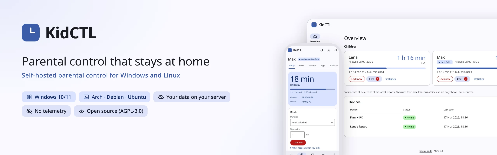

<div align="center">
<a href="https://kidctl.de/">
<picture>
<source media="(prefers-color-scheme: dark)" srcset="docs/img/en/banner-dark.webp">

</picture>
</a>
</div>

# KidCTL

**English** · [Deutsch](README.de.md)

[](https://scorecard.dev/viewer/?uri=github.com/AdrianNoss/kidCTL)  
[](https://www.bestpractices.dev/projects/16981)  
<sub>Scorecard: automatically checked (configuration and repository practices, not a seal); Best Practices: self-assessment against the OpenSSF criteria; report vulnerabilities as described in [SECURITY.md](SECURITY.md).</sub>

Self-hosted parental control for **Windows 10 (22H2) and Windows 11 (23H2 or later)** (x64, Home and Pro) and
**Arch Linux, Debian and Ubuntu** (also Mint, Pop!_OS) **with KDE Plasma or GNOME (Wayland)**. A central server
with a parents' web interface (installable as an app on your phone) controls a root agent on each child's
computer. All data stays on your own server – no cloud, no account with third parties.

The web interface, emails, push notifications and everything the child sees (notifications, tray app) are available
in **English and German**. Parents choose their language in their profile (default: browser language); on the
child's computer the language of the desktop session is used.

## Features

- **Screen time**:
  - Daily allowance and allowed hours per weekday, counted across all of a child's computers.
  - Warnings before the time runs out, then sign-out and sign-in lock (SDDM, GDM and TTY; Windows: the child's
    account is disabled).
  - Also works offline with the last known rules.
- **Game limit**: optional separate daily allowance for games (Steam, Heroic and apps in the
  "Games" group; on Windows also Epic, EA app, GOG Galaxy, Battle.net, Ubisoft Connect and games started by a
  launcher such as Wargaming); games are closed after a warning, the rest of the computer stays usable.
- **Requests and chat**: in the tray app the child asks for more time, more game time or access to a
  blocked app or website, or writes a message; the parents answer from their phone via push –
  "Always allow", "Today only" or "Decline".
- **App allow list**:
  - Modes "Monitor only" or "Block".
  - Catalogue of installed apps, Flatpak (system-wide), Steam and Heroic, on Windows Start menu and Store apps.
  - The child's own programs in the home folder are blocked via noexec (Windows: execution ban on the user profile).
- **Web filter** (DNS):
  - Allow list with service bundles (YouTube, Wikipedia, learning apps, Microsoft 365) or block list with
    block lists (HaGeZi, OISD, StevenBlack).
  - SafeSearch per child.
  - Browsers' DNS-over-HTTPS and DoT are blocked.
- **Reports**: statistics per day, app and game, a log of blocked apps and
  domains, and an optional weekly or monthly usage report by email. **No** history of allowed
  websites is stored.
- **Push alerts**:
  - Device offline for too long.
  - Protection tampered with, e.g. PAM, nftables or noexec.
- **Open with the child**: on first sign-in the tray app explains that the account is managed by KidCTL
  and what is recorded; the icon stays visible, there is no hidden mode.
- **Your data**: export all of a family's data as a ZIP (readable, versioned) and import it on another KidCTL
  server – also for moving between self-hosting and hosted mode.
- **Several families** (`KIDCTL_MODE=saas`): sign-up with an invitation code, subscription with a trial, support
  tickets and an administration area for the operator (roles, log, search).
- **Your own branding:** name, logo and app icon for the web interface, app and emails, with "powered by KidCTL".
  All emails share one layout (light/dark, with a plain-text version), with provider details and imprint in the footer.
- **Newsletter:** news to all families that opted in – in German and English, formatted with Markdown, with a
  preview and an unsubscribe link.
- **Security**:
  - Parent sign-in only with TOTP (or a passkey), rate limiting, CSRF protection.
  - Names, chat, activity log, statistics and email addresses are stored encrypted on the server (one key
    per family).
  - Signed package repository for updates (pacman and APT); the Windows agent updates itself
    (Ed25519-signed).

## Architecture

```
 Parents (browser / PWA)       Child's computer (Arch/Debian, Plasma/GNOME)
          │ HTTPS                          ┌──────────────────────────────┐
          ▼                                │ kidctl-agent (root, systemd) │
 ┌──────────────────────┐   WebSocket      │  time · PAM · processes ·    │
 │ Server (FastAPI)     │◄─────────────────┤  Unbound/nftables · noexec   │
 │ Docker behind Traefik│   (outgoing)     └──────────────┬───────────────┘
 │ PostgreSQL · Web Push│                                 │ Unix socket
 │ /repo (packages)     │                  ┌──────────────┴───────────────┐
 └──────────────────────┘                  │ tray app (PySide6, child)    │
                                           └──────────────────────────────┘
```

- **Server**: Python/FastAPI, SQLAlchemy/PostgreSQL, Jinja2. It also serves the signed
  package repository (pacman and APT) and the Windows installer.
- **Agent**: Python/asyncio as root.
  - The only component holding the device token.
  - Enforces everything at system level: logind, PAM, netlink process events, Unbound per child,
    nftables, systemd mounts.
- **Tray app**: shows remaining time and chat. It is purely cosmetic; closing it doesn't change
  enforcement.

On Windows the agent runs as a Windows service (`LocalSystem`); the tray app talks to it via a named pipe.

Basic rule: root, accounts in `wheel`/`sudo`/`admin` and Windows administrators are **never** restricted.

## Installation

Source code: <https://github.com/AdrianNoss/kidCTL>

Guides: **[wiki](https://kidctl.de/docs/)** (source: [`docs/`](docs/installation.md)).
Step by step in the **[installation guide](https://kidctl.de/docs/installation/)**:
server, package repository, child computers and web interface. Short version:

```bash
# Server
cp .env.example .env            # set SECRET_KEY, BASE_URL; Traefik network in docker-compose.yml
docker compose up -d --build
docker compose exec kidctl python -m app.cli create-parent

# Child's computer (after setting up the repository)
sudo pacman -S kidctl kidctl-plasma   # or kidctl-gnome (both if both desktops are installed)
sudo apt install kidctl kidctl-gnome  # Debian/Ubuntu (or kidctl-plasma)
sudo kidctl enroll https://kids.example.org <PAIRING-CODE>
sudo systemctl enable --now kidctl-agent.service
```

Windows child's computer (as administrator): download `KidCTL-Setup-<version>.exe` from `https://kids.example.org/repo/windows/`
or from the [GitHub releases](https://github.com/AdrianNoss/kidCTL/releases), run it and enter
the server address and pairing code. The installer is not code-signed yet, so SmartScreen asks once
("More info" → "Run anyway"). Details: [Child's computer (Windows)](https://kidctl.de/docs/child-windows/).

Then harden the computers against physical access: **[Hardening](https://kidctl.de/docs/hardening/)**.

## Limitations

- Linux: KDE Plasma and GNOME on Wayland only. Other desktops and X11 are not supported.
  Debian/Ubuntu amd64 only.
- No GDM automatic login for children on GNOME – with the sign-in lock the screen would stay black.
- No protection against physical access without hardening, i.e. against live USB or the boot menu.
- No idle detection. No `flatpak --user`. Steam can only be controlled as a whole.
- VPNs are not actively detected.
- Windows:
  - x64 only (no ARM).
  - No custom notice on the sign-in screen – Windows hides the disabled account.
  - The web filter applies to the whole computer and follows the child signed in at the front (also for services
    and other users in the background). Windows infrastructure (Update, Defender, SmartScreen …) is always allowed.
  - Warning windows don't appear over games in exclusive full screen (sign-out still happens).
  - With app control active, the child can't install anything themselves.
  - Installer without code signature: SmartScreen warning, possible false positives in Defender.

The complete list is in the guides: [Limitations and known gaps](https://kidctl.de/docs/limitations/)
(source [`docs/limitations.md`](docs/limitations.md)).

## Repository layout

| Path | Contents |
|---|---|
| `server/` | FastAPI app, templates, PWA, Dockerfile, tests |
| `agent/` | Root agent (`kidctl_agent`), tests |
| `tray/` | Tray app (`kidctl_tray`) |
| `common/` | Shared, versioned protocol (`kidctl_common`) |
| `packaging/arch/` | PKGBUILD, systemd units, install script |
| `packaging/pam`, `dns`, `mounts`, `sddm`, `gnome` | Sign-in lock, DNS filter and browser policies, noexec, sign-in screen, GNOME adjustments |
| `packaging/repo/`, `debian`, `windows` | Scripts for the signed package repository, `.deb` build for Debian/Ubuntu, Windows installer |
| `website/` | Project website (Hugo) |
| `dev/` | Development server, web interface test script, screenshots, docs check, test VM (QEMU/KVM) |
| `docs/` | Guides (source of the wiki, German `.de.md` and English `.md`) |
| `spec.md` | Living specification with changelog |

## Development

```bash
dev/devserver.sh                 # local server on 127.0.0.1:8000 (creates a test account)

# Tests (venv: pip install --require-hashes -r .github/requirements/tests.txt)
python dev/check_docs_parity.py  # German/English docs are equal
cd server && python -m pytest -q tests
cd agent  && python -m pytest -q tests
cd tray   && QT_QPA_PLATFORM=offscreen python -m pytest -q tests
```

**Never** activate system-level parts such as PAM, nftables and mounts **on the development machine**;
try them in the test VM instead: [`dev/vm/README.md`](dev/vm/README.md). Changes are
described in `spec.md` first and dated in the changelog. Conventions are in
[`CLAUDE.md`](CLAUDE.md). Specification, conventions and code comments are in German; the guides in
`docs/` and this README exist in German (source) and English with the same content. Translations of the
user interface live in `server/app/locale/en.po`, `agent/kidctl_agent/locale/en.po` and
`tray/kidctl_tray/locale/en.po`; tests check that every marked text is translated.

How to contribute (issue, pull request, test policy): [Contributing](CONTRIBUTING.md).

## How kidCTL is built

KidCTL is developed by Adrian Noss **with the help of AI**: most of the code, tests, translations and guides are
written by [Claude Code](https://claude.com/claude-code) (Anthropic). Adrian decides what kidCTL should do, tests on
real devices and approves every release; publishing, signing and running the servers is done by him only. The AI
works with test data only.

Fixed rules keep this reliable: every change is written into [`spec.md`](spec.md) first and recorded there with a
date and test note; no feature without automated tests; system-level parts go to test VMs first; CodeQL, OpenSSF
Scorecard and a monthly web scan keep checking. The AI's working instructions are public in
[`CLAUDE.md`](CLAUDE.md). kidCTL itself uses no AI and sends nothing to AI services. An independent security audit
by humans has not taken place yet. More: [How kidCTL is built](https://kidctl.de/how-kidctl-is-built/).

## Security

Please report security vulnerabilities **confidentially** (GitHub "Report a vulnerability" or security@nossco.de),
never as a public issue: [security policy](SECURITY.md).

## Code signing

The Windows installers are currently **not code-signed**, so Windows SmartScreen asks for confirmation on first
launch. They are built by GitHub Actions from this repository; each release lists the SHA-256
of the installer and links the build run. Process and responsibilities: [Code signing policy](docs/code-signing.md).

## Privacy

KidCTL only talks to the KidCTL server you run yourself – no telemetry, no connection to the
developers or third parties. See the [privacy statement](docs/code-signing.md#privacy).

## License

[GNU Affero General Public License v3.0 or later](LICENSE) (AGPL-3.0-or-later). If you run a modified
server for others, you must offer them its source code; set `SOURCE_URL` to your own fork, then the
"Source code" link in the web interface points there.

Copyright © 2026 Adrian Noss
