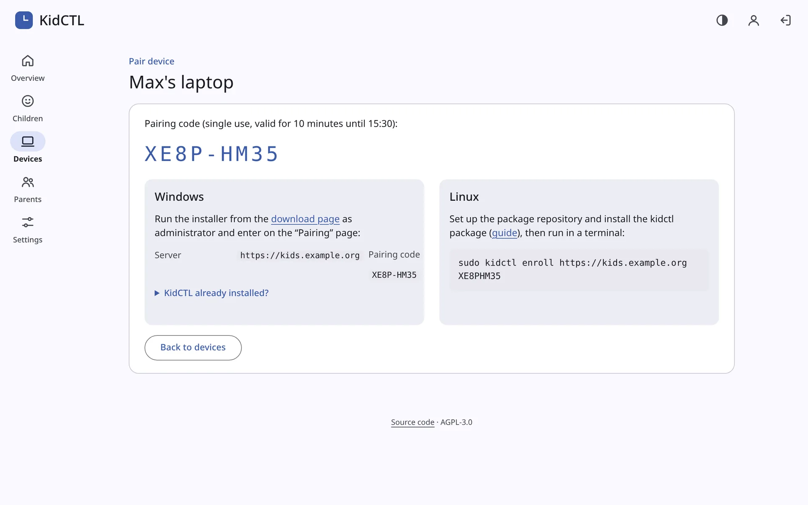
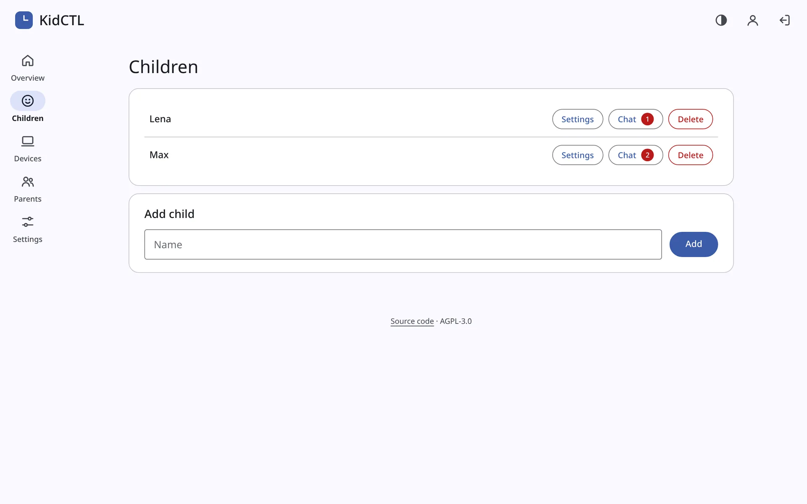
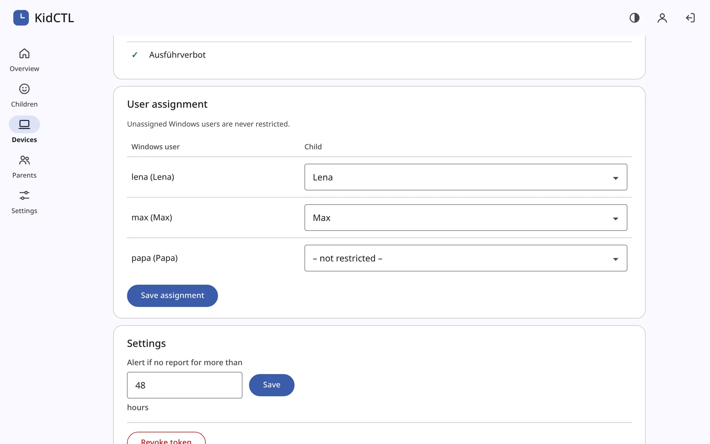

# Child's computer (Linux)

Everything as admin on the child's computer unless stated otherwise.

## Child accounts

Each child gets a **normal** account, i.e. not in `wheel`:

```bash
sudo useradd -m -c "Max" max
sudo passwd max
```

> [!IMPORTANT]
> KidCTL never restricts accounts in `wheel`, `sudo` or `admin`, nor root.
> So as an admin you cannot lock yourself out.

## Set up the repository and install the package

```bash
curl -O https://kids.example.org/repo/kidctl-repo-client.sh
sudo bash kidctl-repo-client.sh https://kids.example.org/repo <FINGERPRINT>           # dry run
sudo bash kidctl-repo-client.sh https://kids.example.org/repo <FINGERPRINT> --apply
# Arch
sudo pacman -S kidctl kidctl-plasma   # KDE Plasma
sudo pacman -S kidctl kidctl-gnome    # GNOME
# Debian, Ubuntu, Mint, Pop!_OS
sudo apt install kidctl kidctl-gnome  # GNOME (Ubuntu, Debian, Pop!_OS 22.04)
sudo apt install kidctl kidctl-plasma # KDE Plasma (Kubuntu)
```

`kidctl-repo-key.sh` shows the fingerprint when the key is created (see
[Package repository](package-repo.md#signing-key-one-time)).

The script detects the distribution: on Arch it checks the downloaded key against the fingerprint,
trusts it locally (`pacman-key --lsign-key`) and adds `[kidctl]` with `SigLevel = Required DatabaseRequired` to
`/etc/pacman.conf` (backup `pacman.conf.kidctl.bak`); on
Debian/Ubuntu it puts the key in `/etc/apt/keyrings/kidctl.asc` and the repository in
`/etc/apt/sources.list.d/kidctl.sources`. After that, updates arrive with the normal system update
(also via Ubuntu's automatic updates).

**Debian/Ubuntu – special notes:**

- The sign-in lock is registered via `pam-auth-update` (profile "kidctl" in `/etc/pam.d/common-account`).
- Ubuntu 24.04 and systems based on it (Mint 22, Pop!_OS) have no PySide6 and only `pydantic` 1: the
  tray app then uses PyQt6 from the system packages, the agent bundles `pydantic` 2 and `websockets` in
  `/usr/lib/kidctl/vendor`. Newer systems (Debian 13, Ubuntu 26.04) use their own packages.
- **Snap apps** (on Ubuntu e.g. Firefox) appear in the app catalogue and are allowed per snap name,
  like Flatpak apps per app ID.
- **Files** (Nautilus) is always allowed on Ubuntu: Ubuntu's desktop icons need it
  running in the background all the time.
- **Steam** from Ubuntu's package `steam-installer` (`/usr/games/steam`) stores its library, as on Arch,
  under `/srv/steam/<child>` (`~/.steam/debian-installation` is a link to it).

If both desktops are installed, install both packages. The script aborts if the key
doesn't match the fingerprint. During installation `kidctl` adds the sign-in lock to
`/etc/pam.d/system-login` (backup `system-login.kidctl.bak`), switches `/etc/nsswitch.conf` to
the DNS filter and activates the browser policies against DNS-over-HTTPS.

| Package | Contents |
|---|---|
| `kidctl` | agent, tray app, `kidctl` command, sign-in lock, web filter |
| `kidctl-plasma` | SDDM theme with the sign-in lock notice |
| `kidctl-gnome` | AppIndicator extension (tray icon in the top bar, preset for all users), "KidCTL" entry in the app overview |

If the matching package for an installed desktop is missing, `pacman` points this out and the web interface
reports it under "Integrity".

**GNOME:** Don't set up automatic login (`AutomaticLogin` in `/etc/gdm/custom.conf`) for children.
If the sign-in lock rejects it at boot, GDM shows no sign-in screen but
stays black (GDM behaviour). The web interface reports such a setting under "Integrity".
If a child switches off the "AppIndicator" extension, only the tray icon is missing – the web interface reports
this; remaining time and chat stay reachable via "KidCTL" in the app overview. To switch it
back on as the child: `gnome-extensions enable appindicatorsupport@rgcjonas.gmail.com`.

Without a repository (e.g. to try it out) you can also install directly from the Git checkout:
`cd packaging/arch && makepkg -si`.

## Pair the device

1. Web interface → "Devices" → "Add device" with a name, e.g. "Laptop Max". A
   pairing code is shown (8 characters, valid for 10 minutes).

   

2. On the child's computer:

   ```bash
   sudo kidctl enroll https://kids.example.org <PAIRING-CODE>
   sudo systemctl enable --now kidctl-agent.service
   ```

3. The device appears as "online" in the web interface.

## Create and assign the child

1. Web interface → "Children" → "Add child".

   

2. Web interface → device → "User assignment": assign the reported Linux accounts to the child. Unassigned accounts stay
   unrestricted.

   

3. Reboot the child's computer so that all protections take effect (noexec home, tray app in
   autostart, sign-in screen).

## Check

```bash
sudo kidctl status                       # policy and today's usage
systemctl status kidctl-agent
journalctl -u kidctl-agent -b            # troubleshooting
```

In the web interface, the "Integrity" section of the device shows whether all protections are active. If
one fails later, a push alert arrives.
