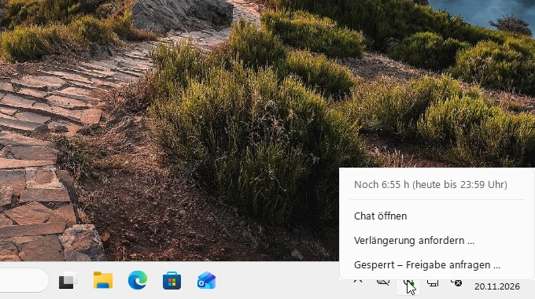

# Kinderrechner (Windows)

Unter Windows 10/11 gibt es in diesem Stand **Bildschirmzeit, Abmeldung, Login-Sperre, „Jetzt sperren“,
Tray-App mit Chat und Verlängerungen, die Programmkontrolle, der Website-Filter und das Spiele-Limit** (Steam,
Epic Games, EA app, GOG Galaxy, Battle.net, Store-Spiele sowie Spiele, die ein Launcher wie Ubisoft Connect oder
Wargaming startet; weitere Apps lassen sich im WebUI als „Spiel“ markieren).

1. **Kinderkonten** als „Standardbenutzer“ anlegen (Einstellungen → Konten → Andere Benutzer), lokale Konten oder
   Microsoft-Konten. Administratoren schränkt KidCTL nie ein – das WebUI meldet zugeordnete Kinder mit
   Administratorrechten unter „Integrität“.
2. WebUI → „Geräte“ → „Gerät hinzufügen“ → Kopplungscode notieren.
3. Auf dem Kinderrechner als Administrator von `https://kids.example.org/repo/windows/` (Liste aller Versionen) `KidCTL-Setup-<Version>.exe`
   herunterladen und ausführen.

   > [!NOTE]
   > Der Installer ist (noch) nicht signiert: Windows SmartScreen zeigt beim ersten Start
   > „Der Computer wurde durch Windows geschützt“ → „Weitere Informationen“ → „Trotzdem ausführen“.
   > Siehe [Code-Signatur](code-signing.de.md).
4. Im Installer Server-Adresse (`https://kids.example.org`) und Kopplungscode eingeben. Später koppeln geht auch
   in einer Eingabeaufforderung als Administrator:

   ```bat
   "C:\Program Files\KidCTL\kidctl.cmd" enroll https://kids.example.org ABCD-EFGH
   ```

5. WebUI → Gerät → „Benutzer-Zuordnung“. Windows-Kontonamen mit Leerzeichen oder Umlauten erscheinen als
   `rid-<Nummer>`, der volle Name (bei Microsoft-Konten mit E-Mail-Adresse) steht daneben.

## Was sich von Linux unterscheidet

- **Login-Sperre:** Ist keine Zeit verfügbar, deaktiviert KidCTL das Konto des Kindes. Windows zeigt dann nur
  „Ihr Konto wurde deaktiviert“ – einen eigenen Hinweis erlaubt der Anmeldebildschirm nicht. Das gilt für jede
  Anmeldeart (Passwort, PIN, Windows Hello) und auch im abgesicherten Modus.
- **Updates** installiert KidCTL selbst (alle 6 Stunden geprüft, signiert). Kein Systemupdate nötig.
- **Aussehen:** Die Tray-App folgt dem Stil von Windows 11 (hell oder dunkel und Akzentfarbe wie in Windows
  eingestellt; unter Windows 10 ohne Mica). Das Tray-Symbol ist das KidCTL-Symbol mit einem farbigen Statuspunkt;
  die Restzeit steht im Tooltip und oben im Menü.

  
- **Benachrichtigungen** sind Windows-Toasts. Ist „Bitte nicht stören“ an (auch automatisch bei Vollbildspielen),
  zeigt die Tray-App die letzte Minute und den Countdown zusätzlich als Fenster im Vordergrund.
- Prüfen: `"C:\Program Files\KidCTL\kidctl.cmd" status`, Dienst „KidCTL“ (`services.msc`), Log unter
  `C:\ProgramData\KidCTL\logs\agent.log`.
- **Programmkontrolle:** Die Programmliste im WebUI zeigt Startmenü-Einträge und Store-Apps (z. B. „Rechner“,
  „Microsoft Edge“). Mit Programmkontrolle kann das Kind im eigenen Profil (Downloads, AppData …) keine Programme
  starten. Apps, die sich ins Profil installieren (Roblox, Discord …), installieren die Eltern mit Programmkontrolle
  „Aus“ im Konto des Kindes und geben sie dann frei – KidCTL macht ihren Ordner dann wieder ausführbar.
- **Website-Filter:** Unter Windows gilt der Filter des Kindes, das gerade vorne angemeldet ist (für den ganzen
  Rechner); ist ein Elternteil vorne, wird nicht gefiltert. Ein Kind, das per „Benutzer wechseln“ im Hintergrund
  angemeldet bleibt, hat währenddessen kein Internet. KidCTL stellt die DNS-Server der Netzwerkadapter auf den
  eigenen Filter um; stoppt ein Administrator den Dienst oder wird KidCTL deinstalliert, kommen die ursprünglichen
  Einstellungen zurück.
- Deinstallieren: Einstellungen → Apps → Installierte Apps → KidCTL. Gesperrte Konten werden dabei wieder aktiviert,
  die Ausführverbote entfernt und die DNS-Einstellungen wiederhergestellt.

## Was der Installer einrichtet

Ein Installer (`KidCTL-Setup-<Version>.exe`, Inno Setup) mit eingebettetem Python 3.14 und allen Bibliotheken –
auf dem Kinderrechner muss nichts weiter installiert sein.

- `C:\Program Files\KidCTL\` – `python\` (eingebettetes Python + Bibliotheken), `lib\` (kidctl), `kidctl.cmd`.
- `C:\ProgramData\KidCTL\` – Zustand, Logs, Updates; Rechte nur SYSTEM und Administratoren (Vererbung entfernt).
- Dienst `KidCTL` (LocalSystem, automatischer Start, Neustart bei Absturz), auch unter
  `HKLM\SYSTEM\CurrentControlSet\Control\SafeBoot\Minimal` und `\Network`.
- Tray-App im Autostart aller Benutzer (`HKLM\…\Run`), Startmenü-Eintrag „KidCTL“ mit AppUserModelID
  `KidCTL.Tray` (nötig für Toasts), Protokoll `kidctl://` für die Knöpfe in Toasts.
- Stille Installation: `KidCTL-Setup-<Version>.exe /VERYSILENT /SERVER=https://… /CODE=ABCD-EFGH`.

## Updates

Der Agent prüft alle 6 Stunden `latest.json`, prüft die Ed25519-Signatur und die SHA-256 des Installers und
führt ihn still aus. Der Installer stoppt Dienst und Tray-Apps, ersetzt die Dateien und startet den Dienst; der
Agent startet die Tray-App in aktiven Kinder-Sitzungen neu.

## Deinstallation

„Apps → Installierte Apps → KidCTL“ (als Administrator). Vorher aktiviert der Uninstaller alle Konten, die
KidCTL gesperrt hat (`kidctl.cmd unlock-all`), danach entfernt er Dienst, Registry-Einträge und
`C:\ProgramData\KidCTL`.

Interna des Pakets (Bau, Signatur): [`packaging/windows/README.md`](../packaging/windows/README.md).
