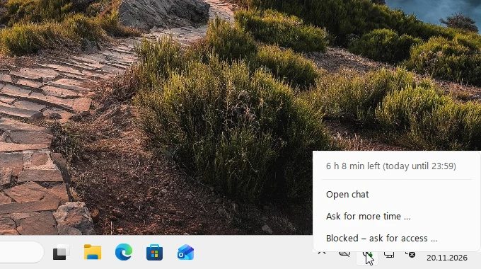

# Child's computer (Windows)

On Windows 10/11 the current version provides **screen time, sign-out, sign-in lock, "Lock now",
the tray app with chat and extensions, app control, the web filter and the game limit** (Steam,
Epic Games, EA app, GOG Galaxy, Battle.net, Ubisoft Connect, Store games and games started by a launcher such as
Wargaming; further apps can be marked as "Game" in the web interface).

1. Create **child accounts** as "Standard user" (Settings → Accounts → Other users), local accounts or
   Microsoft accounts. KidCTL never restricts administrators – the web interface reports assigned children with
   administrator rights under "Integrity".
2. Web interface → "Devices" → "Add device" → note the pairing code.
3. On the child's computer, as administrator, download `KidCTL-Setup-<version>.exe` from `https://kids.example.org/repo/windows/` (list of all versions)
   and run it.

   > [!NOTE]
   > The installer is not code-signed (yet): on first launch Windows SmartScreen shows
   > "Windows protected your PC" → "More info" → "Run anyway".
   > See [Code signing](code-signing.md).
4. Enter the server address (`https://kids.example.org`) and the pairing code in the installer. Pairing later
   also works in a command prompt as administrator:

   ```bat
   "C:\Program Files\KidCTL\kidctl.cmd" enroll https://kids.example.org ABCD-EFGH
   ```

5. Web interface → device → "User assignment". Windows account names with spaces or umlauts appear as
   `rid-<number>`; the full name (for Microsoft accounts with the email address) is shown next to it.

## What differs from Linux

- **Sign-in lock:** when no time is available, KidCTL disables the child's account. Windows then only shows
  "Your account has been disabled" – the sign-in screen doesn't allow a custom notice. This applies to every
  sign-in method (password, PIN, Windows Hello) and also in safe mode.
- **Updates** are installed by KidCTL itself (checked every 6 hours, signed). No system update needed.
- **Appearance:** the tray app follows the Windows 11 style (light or dark and accent colour as set in Windows;
  without Mica on Windows 10). The tray icon is the KidCTL symbol with a coloured status dot; the remaining time is
  shown in the tooltip and at the top of the menu.

  
- **Notifications** are Windows toasts. If "Do not disturb" is on (also automatically during full-screen games),
  the tray app additionally shows the last minute and the countdown as a window in the foreground.
- Check: `"C:\Program Files\KidCTL\kidctl.cmd" status`, service "KidCTL" (`services.msc`), log at
  `C:\ProgramData\KidCTL\logs\agent.log`.
- **App control:** the app list in the web interface shows Start menu entries and Store apps (e.g. "Calculator",
  "Microsoft Edge"). With app control, the child cannot start programs in their own profile (Downloads, AppData …).
  Apps that install into the profile (Roblox, Discord …) are installed by the parents with app control
  "Off" in the child's account and then allowed – KidCTL then makes their folder executable again.
- **Web filter:** on Windows the filter of the child who is currently signed in at the front applies (for the whole
  computer); if a parent is at the front, nothing is filtered. A child who stays signed in in the background via
  "Switch user" has no internet meanwhile. KidCTL points the DNS servers of the network adapters to its
  own filter; if an administrator stops the service or KidCTL is uninstalled, the original
  settings come back.
- Uninstall: Settings → Apps → Installed apps → KidCTL. Locked accounts are re-enabled,
  the execution bans removed and the DNS settings restored.

## What the installer sets up

One installer (`KidCTL-Setup-<version>.exe`, Inno Setup) with embedded Python 3.14 and all libraries –
nothing else needs to be installed on the child's computer.

- `C:\Program Files\KidCTL\` – `python\` (embedded Python + libraries), `lib\` (kidctl), `kidctl.cmd`.
- `C:\ProgramData\KidCTL\` – state, logs, updates; access only for SYSTEM and administrators (inheritance removed).
- Service `KidCTL` (LocalSystem, automatic start, restart on crash), also under
  `HKLM\SYSTEM\CurrentControlSet\Control\SafeBoot\Minimal` and `\Network`.
- Tray app in the autostart of all users (`HKLM\…\Run`), Start menu entry "KidCTL" with AppUserModelID
  `KidCTL.Tray` (needed for toasts), protocol `kidctl://` for the buttons in toasts.
- Silent installation: `KidCTL-Setup-<version>.exe /VERYSILENT /SERVER=https://… /CODE=ABCD-EFGH`.

## Updates

Every 6 hours the agent checks `latest.json`, verifies the Ed25519 signature and the installer's SHA-256 and
runs it silently. The installer stops the service and tray apps, replaces the files and starts the service; the
agent restarts the tray app in active child sessions.

## Uninstalling

"Apps → Installed apps → KidCTL" (as administrator). First the uninstaller re-enables all accounts that
KidCTL has locked (`kidctl.cmd unlock-all`), then it removes the service, registry entries and
`C:\ProgramData\KidCTL`.

Package internals (build, signing): [`packaging/windows/README.md`](../packaging/windows/README.md).
