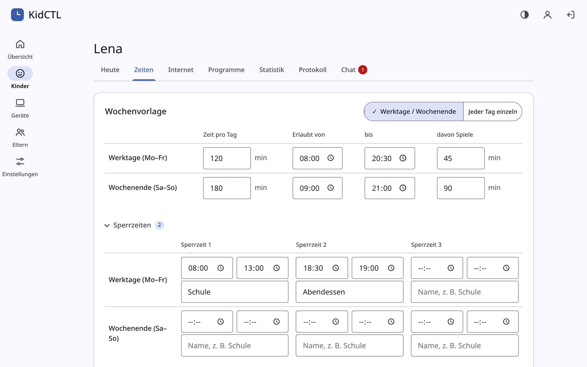
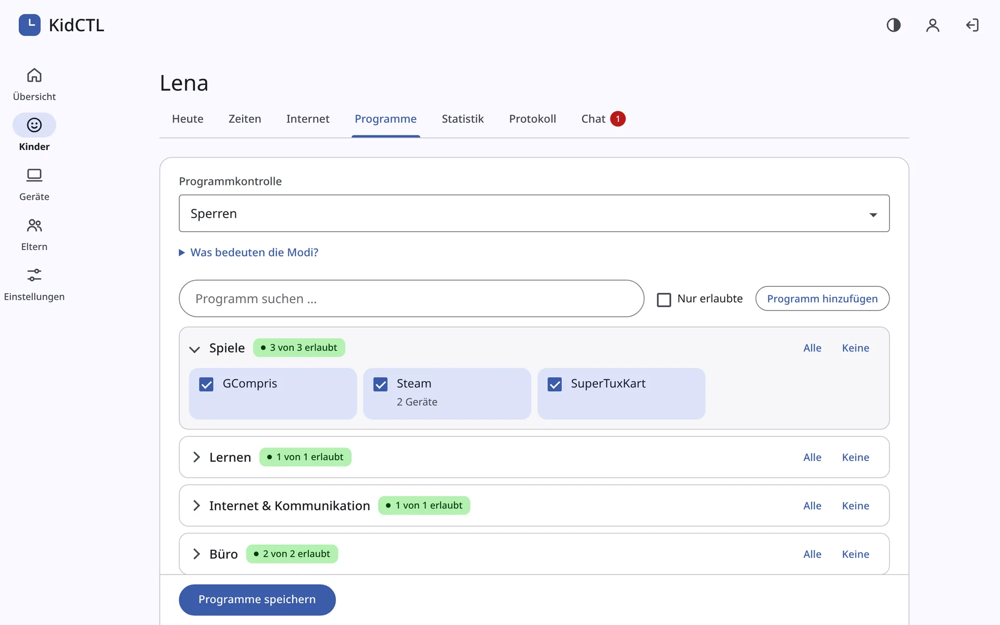
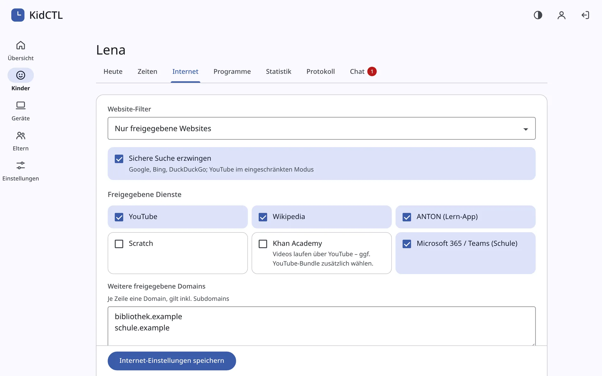
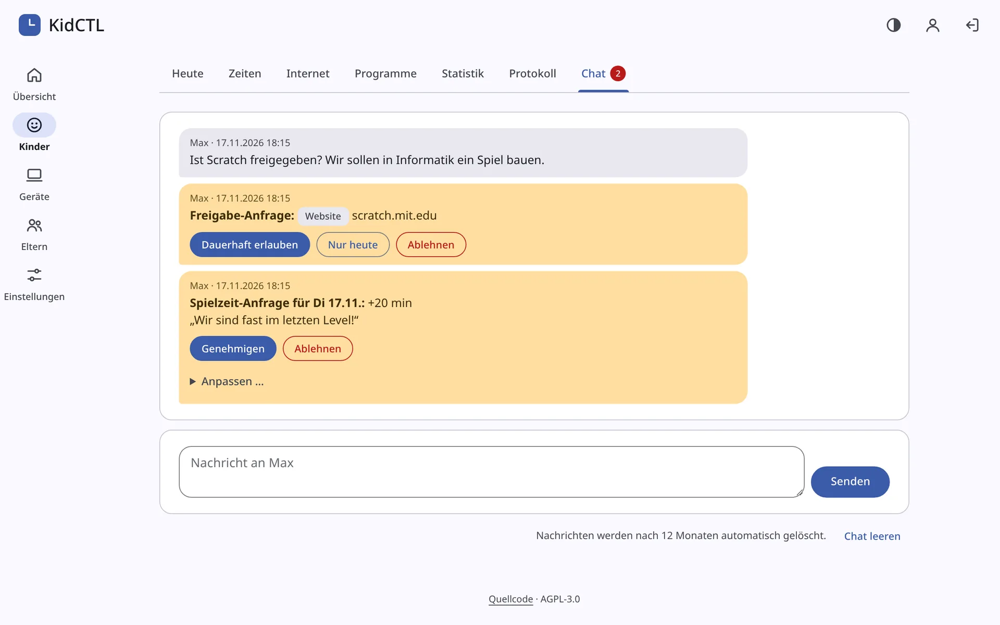

# Einstellungen im WebUI

Je Kind (Seite des Kindes):

- **Bildschirmzeit**: Wochenvorlage mit Tageskontingent und erlaubtem Zeitfenster (Werktage und
  Wochenende oder jeder Tag einzeln). Liegt „bis“ vor „Erlaubt von“ (z. B. 16:00 bis 01:00), reicht das Fenster über
  Mitternacht (Ende spätestens 06:00); die Zeit nach Mitternacht zählt schon zum Kontingent des neuen Tages.
- **Sperrzeiten**: je Tag bis zu drei Zeiten (z. B. Schule 08:00–13:00, Abendessen 18:00–19:00), in denen der Rechner
  trotz Restzeit gesperrt ist – mit Vorwarnung wie am Ende der Zeit. Optional mit Namen, den das Kind in der Tray-App
  sieht. Gutschriften heben Sperrzeiten nicht auf.

  > [!NOTE]
  > Sperrzeiten und Fenster über Mitternacht brauchen KidCTL ab Version 0.47 auf dem Rechner des Kindes. Ältere
  > Versionen setzen nur das Zeitfenster bis höchstens 23:59 Uhr durch; die Seite „Zeiten“ nennt solche Rechner.
- **Spiele-Limit** („davon Spiele“ in der Wochenvorlage): höchstens so viele Minuten Spiele am Tag
  (Steam, Heroic, Lutris, Bottles und Programme der Gruppe „Spiele“, nicht die Launcher; siehe [Spiele](games.de.md)). Vorwarnung 5 und 1 Minute
  vorher, danach werden Spiele geschlossen; der restliche Rechner bleibt nutzbar. Leer = kein Limit.
  Weitere Apps zählen als Spiel, wenn in der Programmliste das Kästchen „Spiel“ unter der App angehakt ist
  (z. B. Roblox oder der Minecraft-Launcher; Apps der Gruppe „Spiele“ sind immer Spiele). Nach dem Speichern stehen
  so markierte Apps – auch eigene Programme – in der Gruppe „Spiele“.

  

- **Ferien und Feiertage**: Ferienzeiträume tragt ihr einmal für die Familie unter *Einstellungen → Ferien &
  Feiertage* ein; an diesen Tagen gilt für jedes Kind seine **Ferienvorlage** (Kind → *Zeiten*, gleiche Felder wie
  die Wochenvorlage; solange sie nicht gespeichert ist, gilt auch in den Ferien die Wochenvorlage). Dort wählt ihr
  auch die **gesetzlichen Feiertage** (Deutschland, Österreich, Schweiz mit Bundesland bzw. Kanton oder nur
  landesweite): Ein Feiertag gilt wie ein wählbarer Wochentag (Standard Sonntag), in den Ferien aus der
  Ferienvorlage. Die Feiertage berechnet der Server selbst, ohne Abruf aus dem Internet. Der Tab *Zeiten* zeigt die
  Ferien- und Feiertage der nächsten 14 Tage. Neue Agenten braucht es dafür nicht.
- **Zeit gutschreiben**: zusätzliche Minuten, ein längeres Zeitfenster oder zusätzliche Spielzeit für
  ein bestimmtes Datum. Verlängerungs- und Spielzeit-Anfragen aus der Tray-App lassen sich auch direkt
  im Chat genehmigen.
- **Programme**:
  - **Aus**
  - **Nur protokollieren**: zum Einstieg empfohlen, um zu sehen, was genutzt wird. Sperrt nichts,
    auch Programme aus dem Home starten. Ausnahme unter Linux: Aus `/tmp`, `/var/tmp` und `/dev/shm`
    startet auf dem ganzen Rechner nichts, unabhängig vom Modus.
  - **Sperren**: nur freigegebene Programme. Der Katalog füllt sich mit dem, was der Rechner
    meldet. Steam wird nur als Ganzes freigegeben.

  

- **Internet** (Website-Filter):
  - **Aus**
  - **Whitelist**: nur Freigegebenes. Dafür gibt es Bundles wie YouTube, Wikipedia, Lern-Apps oder
    Microsoft 365.
  - **Blacklist**: Sperrlisten, z. B. HaGeZi Multi + NSFW, plus eigene Sperren und Ausnahmen.
  - SafeSearch je Kind.

  

- **Statistik**: Nutzung der letzten 14 Tage und Zeit pro Programm.
- **Freigabe-Anfragen**: Wird ein Programm gesperrt, hat die Meldung beim Kind den Knopf
  „Freigabe anfragen“. Gesperrte Websites fragt das Kind über das Tray-Menü „Gesperrt – Freigabe
  anfragen …“ an. Die Anfrage erscheint im Chat (mit Push) mit **Dauerhaft erlauben**, **Nur heute**
  (gilt bis Mitternacht) oder **Ablehnen**. Dauerhafte Freigaben stehen danach in der Programm- bzw.
  Website-Liste und lassen sich dort zurücknehmen.

  

Je Gerät: Alarm, wenn das Gerät länger als X Stunden offline ist (Standard 48 h). Gibt es eine neuere kidCTL-Version,
stößt du das Update auf der Geräteseite per Knopf **Update** an ([Updates](updates.de.md#update-per-knopf)).

## Anmelden und Passkeys

Die Anmeldung hat zwei Schritte: erst E-Mail-Adresse und Passwort, dann der Code aus der Authenticator-App.
Bequemer geht es mit einem **Passkey**. Dann meldest du dich per Fingerabdruck, Gesicht oder Geräte-PIN an, ohne
Passwort und Code. Das Feld für die E-Mail-Adresse schlägt gespeicherte Passkeys vor, alternativ gibt es den Knopf
„Mit Passkey anmelden“.

- **Anlegen:** Profil → „Passkeys“. Zuerst bestätigst du kurz, dass du es bist: mit Passwort und Code oder mit einem
  vorhandenen Passkey. Die Bestätigung gilt 5 Minuten. Dann gibst du einen Namen ein und tippst auf „Passkey
  hinzufügen“. Auf diese Weise legst du auf Handy und Computer je einen an. Passkeys aus iCloud oder Google sind als
  „synchronisiert“ markiert.
- **Löschen** und das Ändern von Passwort oder Authenticator verlangen dieselbe frische Bestätigung. Bei jedem neuen
  oder gelöschten Passkey kommt eine Hinweis-Mail.
- **Wiederherstellung:** „Passwort vergessen“ und das Zurücksetzen des Authenticators entfernen alle Passkeys des
  Kontos. Sie müssen danach neu angelegt werden. „Alle Sitzungen beenden“ lässt Passkeys bestehen.
- Passwort und Authenticator bleiben immer als Weg zur Anmeldung erhalten, auch ohne JavaScript.

> [!NOTE]
> Passkeys sind an die Adresse des Servers gebunden (z. B. `kids.example.org`). Zieht der Server auf eine andere
> Domain um, müssen alle Passkeys neu angelegt werden.

## Sprache

KidCTL spricht Deutsch und Englisch. Eltern wählen die Sprache im Profil (Standard: Browsersprache).
Auf dem Kinderrechner gilt die Sprache der Desktop-Sitzung des Kindes (Plasma: Systemeinstellungen →
Region & Sprache; GNOME: Einstellungen → System → Region & Sprache), vor der Anmeldung unter GNOME
die dort gewählte Sprache, sonst die Systemsprache aus `/etc/locale.conf`. Alles, was nicht mit `de`
beginnt, ergibt Englisch.
