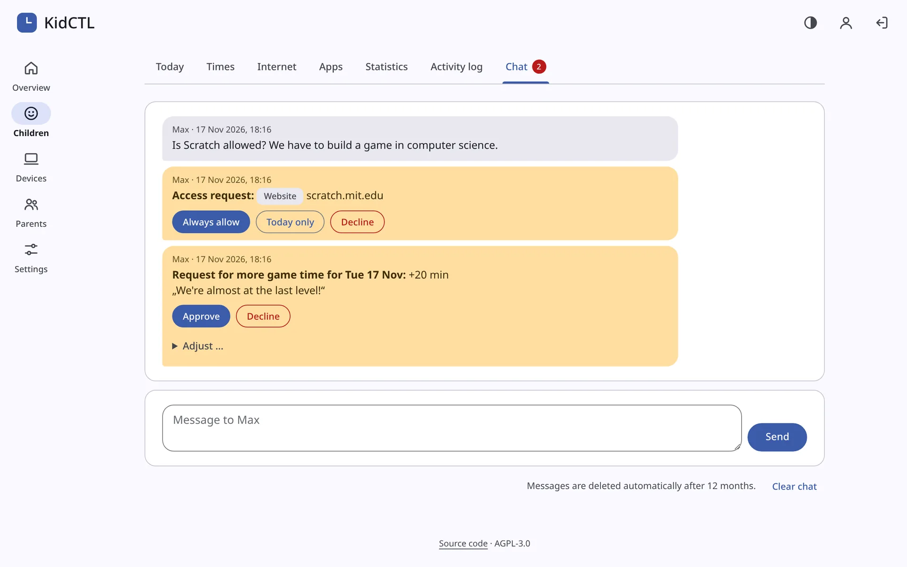

# Settings in the web interface

Per child (the child's page):

- **Screen time**: weekly schedule with daily allowance and allowed hours (weekdays and
  weekend, or each day separately). If "until" is earlier than "Allowed from" (e.g. 16:00 to 01:00), the allowed hours
  run past midnight (ending at 06:00 at the latest); time after midnight already counts towards the next day's allowance.
- **Blocked times**: up to three times per day (e.g. school 08:00–13:00, dinner 18:00–19:00) during which the computer
  is locked even if time is left – with a warning, just like at the end of the time. Optionally named; the child sees
  the name in the tray app. Extra time does not lift blocked times. The section is collapsed as long as no blocked time
  is set.

  > [!NOTE]
  > Blocked times and hours past midnight need KidCTL 0.47 or later on the child's computer. Older versions only
  > enforce the allowed hours up to 23:59; the "Times" page lists such computers.
- **Game limit** ("of which games" in the weekly schedule): at most this many minutes of games per day
  (Steam, Heroic, Lutris, Bottles and apps in the "Games" group, not the launchers; see [Games](games.md)). Warnings 5 and 1 minute
  before, then games are closed; the rest of the computer stays usable. Empty = no limit.
  Further apps count as games if the "Game" box below the app is ticked in the app list
  (e.g. Roblox or the Minecraft launcher; apps in the "Games" group are always games). After saving, apps marked
  this way – including custom programs – are listed in the "Games" group.

  

- **Program limits** (child → *Times*): a separate daily limit in minutes for an app from the app list or a
  category – *Browser*, *Chat* or *Music & video*; at most 20 limits per child, the same value every day. The limit
  applies within screen time: warnings 5 and 1 minute before, then the app is closed and closed again on every
  start until the end of the day; the rest of the computer stays usable. The *Today* tab shows how much of it has
  been used today, the tray app shows the child the time left.
  - Time counts while at least one matching app is open; several at once count once, summed over all of the child's
    computers. "Doesn't count" apps can be limited too.
  - KidCTL detects *Browser* by program name, even without an entry in the app list, and *Chat* and *Music & video*
    by the apps' category (estimated from the name on Windows).
  - Credits, the time bank and approved requests only add screen time, not time for a program limit – for more
    time the parents change the limit. Games are still limited by the game limit.

  > [!NOTE]
  > Program limits need KidCTL 0.48 or later on the child's computer; older versions don't enforce them. The card
  > lists such computers.

- **School holidays and public holidays**: enter school holiday periods once for the family under *Settings →
  Holidays*; on those days each child's **school holiday schedule** applies (child → *Times*, same fields as the
  weekly schedule; until it is saved, the weekly schedule also applies during school holidays). There you also pick
  the **public holidays** (Germany, Austria, Switzerland with state or canton, or nationwide only): a public holiday
  counts as a selectable weekday (default Sunday), taken from the school holiday schedule during school holidays.
  The server calculates public holidays itself, without fetching anything from the internet. The *Times* tab shows
  the school holidays and public holidays of the next 14 days. No new agent is needed for this.
- **Time bank** (child → *Times*, off by default): a selectable share (25, 50 or 100 %) of the minutes not used on
  a day goes to the bank and is allowed in addition on the following days – at most the set amount per day
  (5–120 min), oldest balance first. Balance expires after 1–14 days, the bank holds at most three times the daily
  amount. Only the daily time of the weekly or school holiday schedule counts, not extra time; game limit, allowed
  hours and blocked times stay unchanged. Minutes are saved from the day after switching it on, switching it off
  deletes the balance. The *Today* tab shows how much is added today and how much is in the bank. A day's balance
  reaches a computer as soon as it is connected and then applies offline too until the end of the day; no new agent
  is needed for this.
- **Add time**: extra minutes, longer allowed hours or extra game time for
  a specific date. Extension and game time requests from the tray app can also be approved directly
  in the chat.
- **Apps**:
  - **Off**
  - **Monitor only**: recommended to start with, to see what is being used. Blocks nothing,
    apps in the home folder start too. Exception on Linux: nothing starts from `/tmp`, `/var/tmp`
    and `/dev/shm` on the whole computer, regardless of the mode.
  - **Block**: only allowed apps. The catalogue fills with what the computer
    reports. Steam can only be allowed as a whole.

  

- **Doesn't count** (app list, box below the app): learning apps, office and the like use no screen time as long as
  no other app from the list and no game is open besides them. An empty desktop counts as before, and so does any
  open browser. Allowed hours and blocked times still apply; once screen time is used up, the session ends as usual.
  The apps still appear in the statistics, and the tray app shows the child "Your time is not running right now".
  - Browsers, terminals, file managers, development tools, game launchers and games cannot be exempted – the
    child's computer checks this itself as well.
  - Apps running in the background (e.g. update notifier, cloud sync) count as open; mark them as "Doesn't count"
    too if needed.
  - On Windows only for apps under "Program Files" and Store apps, not for apps in the user folder.

  > [!NOTE]
  > "Doesn't count" needs KidCTL 0.48 or later on the child's computer; older versions keep counting every minute.
  > The "Apps" page lists such computers.

- **Internet** (web filter):
  - **Off**
  - **Allow list**: only what is allowed. There are bundles such as YouTube, Wikipedia, learning apps or
    Microsoft 365.
  - **Block list**: block lists, e.g. HaGeZi Multi + NSFW, plus your own blocks and exceptions.
  - SafeSearch per child.
  - Your own allowed or blocked domains: at most 1,000 per field.

  

- **Statistics**: usage over the last 14 days and time per app.
- **Access requests**: when an app is blocked, the notification on the child's computer has the button
  "Ask for access". The child requests blocked websites via the tray menu "Blocked – ask for
  access …". The request appears in the chat (with push) with **Always allow**, **Today only**
  (valid until midnight) or **Decline**. Permanent approvals then appear in the app or
  website list and can be withdrawn there.

  

Per device: alert when the device has been offline for more than X hours (default 48 h). If a newer kidCTL version is
available, start the update with the **Update** button on the device page ([Updates](updates.md#update-via-button)).

## Signing in and passkeys

Signing in takes two steps: first email address and password, then the code from the authenticator app. A **passkey**
is more convenient: you sign in with your fingerprint, face or device PIN, without password and code. The email field
suggests saved passkeys, or use the "Sign in with a passkey" button.

- **Create:** Profile → "Passkeys". First you briefly confirm that it is you: with password and code or with an existing
  passkey. The confirmation lasts 5 minutes. Then enter a name and tap "Add passkey". This way you create one on your
  phone and one on your computer. Passkeys from iCloud or Google are marked as "synced".
- **Deleting** and changing your password or authenticator require the same fresh confirmation. Every new or deleted
  passkey triggers a notification email.
- **Recovery:** "Forgot password" and resetting the authenticator remove all passkeys of the account. They have to be
  created again afterwards. "Sign out all sessions" keeps passkeys.
- Password and authenticator always remain available for signing in, also without JavaScript.

> [!NOTE]
> Passkeys are bound to the server's address (e.g. `kids.example.org`). If the server moves to another domain, all
> passkeys have to be created again.

## Language

KidCTL speaks English and German. Parents choose the language in their profile (default: browser language).
On the child's computer, the language of the child's desktop session applies (Plasma: System Settings →
Region & Language; GNOME: Settings → System → Region & Language); before sign-in on GNOME
the language chosen there, otherwise the system language from `/etc/locale.conf`. Everything that doesn't
start with `de` results in English.

## Suggest a feature

Settings → "Suggest a feature" (in hosted operation also on the *Support* page): title (at most 120 characters),
category, description (at most 5000 characters) and optionally how important the wish is to you. The suggestion is
sent by email to the development team. Your email address is only included if you tick "Follow-up questions allowed";
this needs a confirmed address in your profile. Each parent can send up to 5 suggestions a day.

> [!NOTE]
> When self-hosting, the feature is off until `FEATURE_REQUEST_EMAIL` is set
> ([Server](server.md#configuration-env)). Without it, no suggestion leaves the server.
