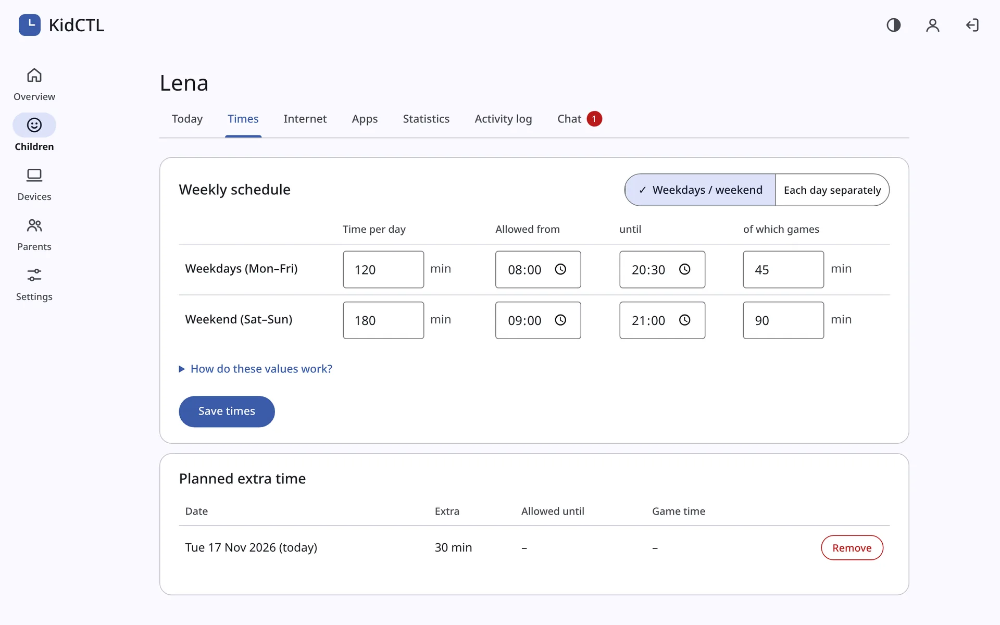
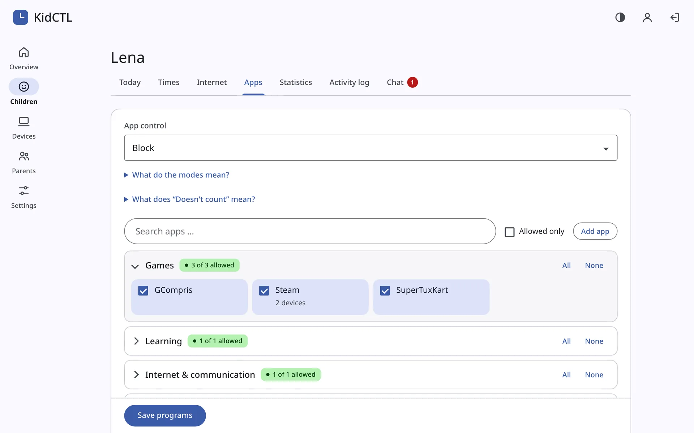
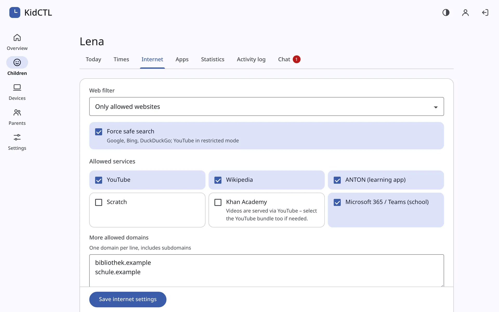

# Settings in the web interface

Per child (the child's page):

- **Screen time**: weekly schedule with daily allowance and allowed hours (weekdays and
  weekend, or each day separately).
- **Game limit** ("of which games" in the weekly schedule): at most this many minutes of games per day
  (Steam, Heroic and apps in the "Games" group, not the launchers; see [Games](games.md)). Warnings 5 and 1 minute
  before, then games are closed; the rest of the computer stays usable. Empty = no limit.
  Further apps count as games if the "Game" box below the app is ticked in the app list
  (e.g. Roblox or the Minecraft launcher; apps in the "Games" group are always games). After saving, apps marked
  this way – including custom programs – are listed in the "Games" group.

  

- **Add time**: extra minutes, longer allowed hours or extra game time for
  a specific date. Extension and game time requests from the tray app can also be approved directly
  in the chat.
- **Apps**:
  - **Off**
  - **Monitor only**: recommended to start with, to see what is being used.
  - **Block**: only allowed apps. The catalogue fills with what the computer
    reports. Steam can only be allowed as a whole.

  

- **Internet** (web filter):
  - **Off**
  - **Allow list**: only what is allowed. There are bundles such as YouTube, Wikipedia, learning apps or
    Microsoft 365.
  - **Block list**: block lists, e.g. HaGeZi Multi + NSFW, plus your own blocks and exceptions.
  - SafeSearch per child.

  

- **Statistics**: usage over the last 14 days and time per app.
- **Access requests**: when an app is blocked, the notification on the child's computer has the button
  "Ask for access". The child requests blocked websites via the tray menu "Blocked – ask for
  access …". The request appears in the chat (with push) with **Always allow**, **Today only**
  (valid until midnight) or **Decline**. Permanent approvals then appear in the app or
  website list and can be withdrawn there.

  

Per device: alert when the device has been offline for more than X hours (default 48 h).

## Signing in and passkeys

Signing in takes two steps: first email address and password, then the code from the authenticator app. A **passkey**
is more convenient: you sign in with your fingerprint, face or device PIN, without password and code. The email field
suggests saved passkeys, or use the "Sign in with a passkey" button.

- **Create:** Profile → "Passkeys". First you briefly confirm that it is you: with password and code or with an existing
  passkey. The confirmation lasts 5 minutes. Then enter a name and tap "Add passkey". This way you create one on your
  phone and one on your computer. Passkeys from iCloud or Google are marked as "synced".
- **Deleting** and changing your password or authenticator require the same fresh confirmation. Every new or deleted
  passkey triggers a notification email.
- **Recovery:** "Forgot password" and resetting the authenticator remove all passkeys of the account. They have to be
  created again afterwards. "Sign out all sessions" keeps passkeys.
- Password and authenticator always remain available for signing in, also without JavaScript.

> [!NOTE]
> Passkeys are bound to the server's address (e.g. `kids.example.org`). If the server moves to another domain, all
> passkeys have to be created again.

## Language

KidCTL speaks English and German. Parents choose the language in their profile (default: browser language).
On the child's computer, the language of the child's desktop session applies (Plasma: System Settings →
Region & Language; GNOME: Settings → System → Region & Language); before sign-in on GNOME
the language chosen there, otherwise the system language from `/etc/locale.conf`. Everything that doesn't
start with `de` results in English.
